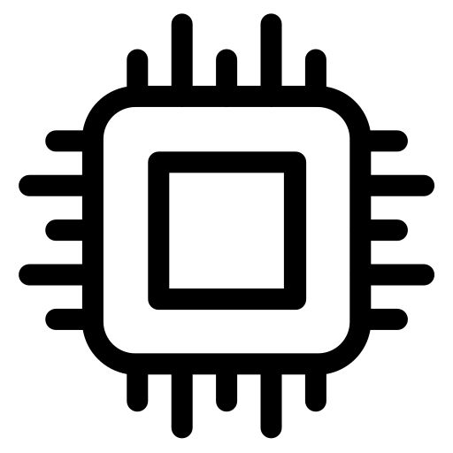
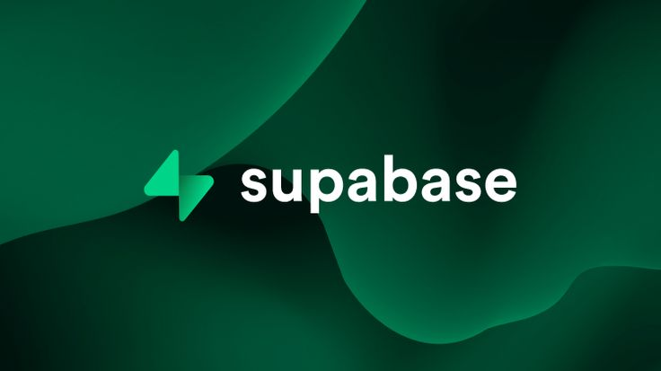

<p align="center">
  
</p>

<h1 align="center">ElectronicShop</h1>

<p align="center">
  La tienda de componentes electrónicos para estudiantes de ingeniería.<br />
  Arduino, ESP32, sensores, kits y herramientas, con entrega en el campus.
</p>

<p align="center">
  <a href="https://electronicshop-eight.vercel.app"><strong>Ver la tienda en vivo</strong></a>
</p>

<p align="center">
  
</p>

---

## De qué se trata

ElectronicShop ya existía. Era una tienda hecha en WordPress con WooCommerce, de esas que funcionan pero se sienten de hace diez años: lentas en el celular, con fotos planas y sin nada que la distinguiera de cualquier otra.

La idea era rehacerla desde cero con tres cosas en mente. Que los productos se pudieran ver en 3D. Que moverse por la página se sintiera bien, con animaciones cuidadas y no de adorno. Y que fuera rápida y fácil de mantener.

Este documento explica qué se construyó, con qué herramientas y cómo funciona por dentro, sin dar por hecho que sabes programar.

## Qué puede hacer la tienda

- **Catálogo** con 19 productos en 7 categorías, buscador, filtros y orden por precio.
- **Ficha de cada producto** con fotos, especificaciones, productos relacionados y un botón "Ver en 3D" en los que tienen modelo.
- **Visor 3D**: la placa de desarrollo, la resistencia, el capacitor y el sensor de movimiento se pueden girar y acercar con el mouse o con el dedo.
- **Carrito y favoritos** que se guardan en tu navegador aunque cierres la pestaña.
- **Compra como invitado o con cuenta.** Recoger en el campus es gratis; el envío express cuesta $99 y sale gratis desde $1,500.
- **Cuentas de usuario**: crear cuenta, iniciar sesión, recuperar la contraseña y ver tus pedidos con su estado en "Mi cuenta".
- **Formulario de contacto** cuyos mensajes quedan guardados.
- **Electric**, un asistente de chat que responde sobre productos, horarios, entregas, pagos y preguntas frecuentes.
- **Páginas de Servicios, Nosotros y Preguntas frecuentes.**
- **Funciona igual de bien en celular** (iPhone y Android) que en computadora.

## Cómo se ve

El diseño se pensó como una mesa de trabajo de laboratorio. Fondo claro color hueso, texto casi negro para que se lea sin esfuerzo y un solo color de acento: el cobre, como el de las pistas de una placa de circuito.

Algunos detalles que vale la pena notar cuando la visites:

- El fondo es una malla que se enciende por cuadritos al pasar el cursor, pero nunca encima del texto.
- Las tarjetas parecen de vidrio: dejan ver borroso lo que hay detrás y brillan un poco donde está el mouse.
- En la portada, unos mosaicos de productos flotan y se apartan cuando el cursor se acerca.
- El visor 3D de la portada va cambiando de producto solo, cada 7 segundos.
- En "Nosotros", los textos de misión y visión se arman como si fueran polvo que se junta.

Si alguien tiene activada la opción de "reducir movimiento" en su sistema, las animaciones se apagan solas.

## Con qué está hecho

Estas son las herramientas. No hace falta dominarlas para entender el proyecto, pero conviene saber qué hace cada una.

| | Herramienta | Para qué sirve aquí |
|:-:|---|---|
|  | **Next.js** | Es el armazón de todo el sitio. Organiza las páginas, hace que carguen rápido y que Google las pueda encontrar. |
|  | **React** | Permite armar la pantalla con piezas reutilizables, como bloques de Lego: una tarjeta de producto se diseña una vez y se usa en todo el sitio. |
|  | **TypeScript** | El lenguaje en que está escrito casi todo el proyecto. Es JavaScript con un corrector integrado que avisa de muchos errores antes de publicar. |
|  | **Tailwind CSS** | Le da el estilo a todo: colores, tamaños, espacios y cómo se acomoda en pantallas chicas. |
|  | **Three.js** | Dibuja los modelos 3D dentro del navegador. Se usa junto con React Three Fiber, que lo conecta con React. |
|  | **Supabase** | La base de datos y el sistema de cuentas. Ahí se guardan usuarios, pedidos y mensajes. |
|  | **PostgreSQL** | El motor de la base de datos que vive dentro de Supabase. Las reglas de seguridad están escritas en su lenguaje, SQL. |
|  | **Vercel** | Publica el sitio en internet y lo actualiza cada vez que hay un cambio. |
|  | **GitHub** | Guarda el código y todo su historial de cambios. Es donde estás leyendo esto. |

Las animaciones usan una librería llamada **Motion**, y los íconos vienen de **Lucide**. No hay emojis en ningún lado; fue una decisión de diseño.

**Lenguajes:** TypeScript para casi todo, CSS para los estilos y SQL para la base de datos.

## Los servicios: Vercel y Supabase

El sitio vive en dos servicios externos. Los dos tienen un plan gratuito que alcanza de sobra para un proyecto de este tamaño, y es el que se está usando.

### Vercel, donde vive la página

<p align="center">
  
</p>

Vercel es el que pone la tienda en internet. Está conectado con este repositorio de GitHub, así que cada vez que se sube un cambio, Vercel arma una versión nueva del sitio y la publica sola, en menos de un minuto. Nadie tiene que subir archivos a mano.

Si algo sale mal en una versión nueva, desde el panel de Vercel se puede regresar a la anterior con un clic. También guarda un registro de errores, útil para enterarse de un problema antes de que alguien lo reporte.

La dirección actual es `electronicshop-eight.vercel.app`. Cuando se compre un dominio propio, se conecta desde el mismo panel.

### Supabase, donde viven los datos

<p align="center">
  
</p>

Supabase guarda todo lo que tiene que sobrevivir aunque cierres el navegador: las cuentas, los perfiles, los pedidos con sus productos y los mensajes de contacto. También se encarga de las contraseñas. Las guarda cifradas, así que nadie puede leerlas, ni siquiera quien administra la tienda.

El proyecto se llama `electroshop` y está en servidores de Virginia, Estados Unidos, la misma región que usa Vercel, para que la página y la base de datos se hablen rápido.

Un detalle del plan gratuito: si el proyecto pasa una semana sin uso, Supabase lo pone en pausa. Se reactiva desde su panel con un clic.

## Cómo funciona una compra, paso a paso

1. Eliges productos y los mandas al carrito. El carrito vive en tu navegador; todavía no se manda nada a ningún lado.
2. En el pago llenas tu nombre, teléfono y correo, y eliges cómo recibirlo y cómo pagar.
3. Al confirmar, la página le pide a Supabase que registre el pedido. Solo le manda qué productos y cuántos de cada uno.
4. Supabase revisa todo: que los datos tengan sentido, que haya existencias y que esa persona no esté mandando pedidos en ráfaga. Los precios los toma de su propio catálogo, nunca de lo que diga el navegador.
5. Si todo está bien, guarda el pedido y responde con su número. Ves la pantalla de confirmación.
6. Si iniciaste sesión, el pedido queda ligado a tu cuenta y aparece en "Mi cuenta" con su estado.
7. Cuando el pedido se marca como pagado desde el panel de Supabase, las existencias de esos productos bajan solas. Si se cancela, regresan.

## La seguridad, explicada sin rodeos

La regla principal es que **la base de datos no confía en nadie**. Cualquiera puede abrir las herramientas del navegador y mandar datos falsos, así que todas las protecciones importantes viven del lado de Supabase, no en la página.

- **Cada quien ve solo lo suyo.** Una cuenta puede leer su perfil y sus pedidos, nada más. Nadie puede ver pedidos, datos o mensajes de otras personas.
- **Nadie escribe directo en la base de datos.** Los pedidos y los mensajes solo entran por una "puerta" que revisa cada dato antes de guardarlo.
- **Los precios no se pueden alterar.** Si alguien modifica el precio en su navegador, se ignora; se cobra el del catálogo.
- **Hay límites contra el spam.** Un mismo correo puede hacer hasta 3 pedidos y mandar hasta 3 mensajes por hora.
- **Los pedidos falsos no vacían el inventario**, porque las existencias solo bajan cuando el pedido se marca como pagado.
- **Contraseñas firmes:** mínimo 8 caracteres, con letras y números.
- **La página no se puede meter dentro de otra.** Así se evita que un sitio falso la muestre para engañar a alguien.
- **El navegador solo carga código de la propia tienda**, nunca de otros sitios, y lo que escribe un usuario siempre se muestra como texto, no como código.

Antes de publicar, todo esto se puso a prueba intentando atacar la base de datos directamente: leer pedidos ajenos, cambiar precios, borrar productos, meter comandos en los formularios y mandar decenas de pedidos al mismo tiempo. Ninguno de esos ataques funcionó.

## Cómo se construyó

El proyecto avanzó por etapas, y cada una se revisó antes de pasar a la siguiente.

1. **Análisis de la tienda anterior.** Se revisaron sus páginas, productos, textos y fotos para entender qué había y qué faltaba.
2. **Concepto de diseño.** Se definieron los colores, la tipografía (Instrument Sans y JetBrains Mono), el estilo de vidrio y las animaciones.
3. **Construcción de las páginas**: inicio, tienda, producto, carrito, pago, cuenta, contacto y el resto.
4. **Rondas de ajustes.** Muchas. Tamaños de títulos, contraste del texto, la línea de tiempo de "Cómo funciona", el pie de página negro, el visor 3D y el chat. Cada página terminó siguiendo el mismo patrón visual.
5. **Optimización para celular**, revisando que nada se desbordara, que los botones fueran fáciles de tocar y que el menú se viera bien.
6. **Publicación en GitHub y Vercel**, con publicación automática en cada cambio.
7. **Base de datos y cuentas con Supabase**, con las reglas de seguridad de arriba, pruebas de ataque y una revisión independiente del código.

## Cómo administrar la tienda

Casi todo se hace desde el panel de Supabase, en **Table Editor**:

| Quieres... | Dónde |
|---|---|
| Ver los pedidos | Tabla `orders` |
| Ver qué productos lleva cada pedido | Tabla `order_items` (cada renglón dice a qué pedido pertenece) |
| Marcar un pedido como pagado | En `orders`, cambia `status` a `pagado`. Los otros estados son `listo`, `entregado` y `cancelado` |
| Leer los mensajes de contacto | Tabla `contact_messages` |
| Ver los usuarios registrados | Menú **Authentication**, sección **Users** |
| Ver nombre y carrera de cada usuario | Tabla `profiles` |
| Revisar las existencias | Tabla `products`, columna `stock` |

Para ver cada pedido junto con sus productos en una sola lista, pega esto en el **SQL Editor** de Supabase:

```sql
select o.created_at, o.name, o.email, o.status, o.total, i.name as producto, i.qty
from orders o
join order_items i on i.order_id = o.id
order by o.created_at desc;
```

Por ahora, los productos que se muestran en la página están escritos en el código, en `lib/data/products.ts`. Si cambias un precio, cámbialo en los dos lugares: en ese archivo, que es lo que se ve, y en la tabla `products` de Supabase, que es lo que se cobra.

## Cómo está organizado el código

| Carpeta o archivo | Qué hay ahí |
|---|---|
| `app/` | Cada página de la tienda: inicio, tienda, producto, carrito, pago, cuenta, contacto, etc. |
| `components/` | Las piezas reutilizables: tarjetas, botones, el visor 3D, el chat, el menú |
| `lib/data/` | El catálogo, las categorías, las preguntas frecuentes y los datos de contacto |
| `lib/` | El carrito, las respuestas del chat Electric y la conexión con Supabase |
| `supabase/` | Las instrucciones que crean la base de datos, sus reglas de seguridad y los productos iniciales |
| `public/` | Imágenes de la tienda |
| `proxy.ts` | El "portero": revisa la sesión en cada visita y cuida que solo tú entres a tu cuenta |
| `docs/readme/` | Las imágenes de este documento |

## Si quieres correrlo en tu computadora

Necesitas tener instalado [Node.js](https://nodejs.org) en versión 20 o más nueva.

1. Descarga el proyecto y, dentro de la carpeta, instala lo necesario:

   ```bash
   npm install
   ```

2. Haz una copia del archivo `.env.example` y llámala `.env.local`. Ahí van dos datos de Supabase que encuentras en su panel, en el botón **Connect**: la dirección del proyecto y la llave pública.

3. Arranca la tienda:

   ```bash
   npm run dev
   ```

4. Abre `http://localhost:3000` en tu navegador.

Si te saltas el paso 2, la tienda funciona igual en **modo demostración**: puedes navegar, llenar el carrito y simular compras, pero nada se guarda.

Para montar la base de datos desde cero en otro proyecto de Supabase, abre su **SQL Editor** y ejecuta, en este orden, los archivos de `supabase/migrations/` (`0001`, `0002` y `0003`) y luego `supabase/seed.sql`, que carga los productos.

El archivo `.env.local` nunca se sube a GitHub. Está excluido a propósito para que ninguna llave quede pública.

## Lo que sigue

- **Pagos en línea reales**, por ejemplo con Mercado Pago. Hoy la tienda registra el método de pago que eligió el cliente, pero todavía no cobra en línea.
- **Correos propios** con un servicio como Resend. Así "¿Olvidaste tu contraseña?" funcionaría para cualquier estudiante, porque el correo gratuito de Supabase solo le llega al equipo del proyecto.
- **Un dominio propio**, como `electronicshop.mx`.
- **Fotos reales** del equipo y modelos 3D de más productos.
- **Que la tienda lea los productos directo de la base de datos**, para cambiar precios y existencias sin tocar el código.

---

<p align="center">
  Hecho por <a href="https://github.com/Eviix90s">Alejandro (Eviix90s)</a>
</p>
